# `git-nt`

**Pure-Rust Negative-Space memory and prompt-injection-hardened context hydration for Git.**

> Rust 2024 · Zero C dependencies · `#![forbid(unsafe_code)]` · `737 KiB` stripped binary · Apache-2.0

Standard Git stores only code that survived. Every failed AI attempt, Critic rejection, and discarded architectural dead end is overwritten and forgotten—forcing fresh coding-agent sessions to rediscover and repeat the same concurrency, safety, and contract regressions.

`git-nt` (`v0.1.0` / Architecture Rev 4.1) stores typed **Negative-Space tombstones** as immutable, per-event RFC 8785 JCS JSON files (`.nt/ns/{uuid7}.json`) committed alongside code, then delivers them back to coding agents through a **4-Layer Indirect Prompt-Injection Defense** and a compile-time-isolated, strictly read-only **Model Context Protocol (MCP)** server.

---

## How It Works

```mermaid
flowchart LR
  A["Coding Agent / Critic"] -->|"git nt stage (--from-json)"| B[".git/nt-stage/{uuid7}.json\n(lock-free atomic staging)"]
  B -->|"git nt commit / promote\n(atomic claim + diff filter)"| C[".nt/ns/{uuid7}.json\n(tracked, reviewed, signed)"]
  C -->|"PR review & merge"| D["refs/heads/main\n(trusted Git tree)"]
  D -->|"L1 Trusted Tree + Sig Gate\nL2 Sanitizer · L3 CSPRNG Spotlighting"| E["git nt hydrate / nt-mcp\n(strictly read-only stdio)"]
```



1. **Stage lock-free during development:** Multiple agents or worktrees write immutable events to `.git/nt-stage/{uuid7}.tmp` → `sync_all()` → atomic POSIX `rename(2)` → `.json`, with fail-closed secret detection and local-only streaming SHA-256 hashing for raw `<think>` logs.
2. **Promote only what belongs to the commit:** `git nt commit -- <git args>` (or standalone `git nt promote` for IDE / plain `git commit` / `jj` workflows) atomically claims staged files whose `files` overlap the Git diff, writes RFC 8785 JCS JSON into `.nt/ns/{uuid7}.json`, preserves native `git commit` hooks & GPG/SSH signing, and rolls back atomically on any commit failure.
3. **Hydrate safely from trusted mainline history:** `git nt hydrate <file>` and MCP `nt_hydrate_file` read `.nt/ns/` strictly from the trusted ref's Git tree (`refs/heads/main`, never the local working tree), apply deterministic L2 sanitization, and wrap results in a fresh 128-bit OS CSPRNG Spotlighting envelope.
4. **Retire stale invariants cleanly:** `git nt retire <id>` records an immutable `status: "retired"` superseding tombstone (or `--delete`), and `git nt audit` flags non-canonical JCS, oversized records, leaked secrets, and orphaned/renamed paths.

---

## Core Design Guarantees

* **Zero C Dependencies:** Compiles cleanly with `CC=/bin/false CXX=/bin/false cargo build --release`. Zero C/C++ build scripts or C-backed `*-sys` crates (`libsqlite3-sys`, `libgit2-sys`, OpenSSL).
* **Ultra-Compact Single Binary:** Rust 2024 workspace (`#![forbid(unsafe_code)]`) producing a **`737 KiB`** (`755,200` B) stripped release binary (well under the `3 MiB` target and `6 MiB` CI ceiling).
* **Compile-Time Read/Write Isolation:** VCS logic is split into `nt-read` and `nt-write`; `nt-mcp` depends **only** on `nt-core` and `nt-read` (verified mechanically in CI via `cargo tree -p nt-mcp`).
* **Native Git & Rewrite Survival:** Immutable per-event `.nt/ns/{uuid7}.json` files never merge-conflict and survive `git commit --amend`, `git rebase --onto`, squash-merges, `git push`/`git pull`, GPG/SSH commit signing, and colocated Jujutsu (`jj`) natively with zero push/rewrite hooks or reconcilers.
* **True RFC 8785 JCS Canonicalization:** Direct `serde::Serializer` with explicit UTF-16 code-unit key sorting, ECMA-262 IEEE 754 binary64 number formatting (with `float_roundtrip`), non-finite float rejection (`NaN`/`Infinity`), and `< 1.5 KiB` (`1,536` B) per-tombstone ceiling.
* **Local-Only Reasoning Traces:** Raw `<think>` logs remain strictly local and Git-ignored (`.nt-local/`); only their streaming `sha256:` digest enters tombstones.

---

## Security: 4-Layer Indirect Prompt-Injection Firewall

### Threat Model
* **Untrusted PR / feature branch:** Mitigated by **L1** — hydration reads `.nt/ns/` strictly from `refs/heads/main`'s Git tree, never from the local working tree.
* **Prompt-injected local agent with shell access:** A read-only MCP server cannot stop a shell-capable agent from running shell commands; defense relies on mandatory human/CI diff review before `.nt/ns/` edits can land on `refs/heads/main`.
* **Adversarial content reaching `main`:** Defense-in-depth via **L2** structural/Unicode/secret sanitization and **L3** per-call 128-bit CSPRNG Spotlighting.
* **Read-only MCP clients:** Enforced at compile time and runtime by **L4**.

### The Four Layers

1. **Layer 1 — Trusted Tree & Signature Gate (`nt-read`):** Reads `.nt/ns/*.json` strictly from `nt.trustedRef` (default `refs/heads/main`) via hardened native `git` (`-c core.fsmonitor=false -c core.hooksPath=/dev/null`). When `nt.requireSigned=true`, verifies introducing/last-modifying commit signatures (`%G? == G`, cached per commit SHA) and drops unsigned tombstones—including unsigned retirement attempts.
2. **Layer 2 — Deterministic Sanitizer (`nt-core`):** Enforces closed `FailureClass` & `RecordStatus` enums; strips ASCII/Unicode controls, Bidi overrides/isolates, zero-width chars, Unicode Tags (`U+E0000..=U+E007F`), and Variation Selectors (`U+FE00..=U+FE0F`, `U+E0100..=U+E01EF`); **preserves benign code syntax** (`<`, `>`, single backticks, `Vec<u8>`, `Option<User>`, `->`, `=>`, `<=`, `task-queue`, `Basic authentication`); neutralizes triple backticks, outer LLM/tool XML boundary tags, and spotlight marker prefixes; redacts URLs, shell download/pipe chains, and anchored secrets via linear-time `regex-lite`; caps fields at `<= 240` Unicode scalars idempotently.
3. **Layer 3 — 128-Bit CSPRNG Spotlighting (`nt-core`):** Draws 16 fresh OS CSPRNG bytes (`getrandom`) per invocation to frame passive anti-context inside unguessable boundaries (`<<<NT_DATA_{hex}<<< ... >>>END_NT_DATA_{hex}>>>`) within a hard `16 KiB` total output cap.
4. **Layer 4 — Compile-Time Read-Only MCP (`nt-mcp`):** Speaks newline-delimited JSON-RPC 2.0 on `stdio` (`64 KiB` bounded frame reader, diagnostics strictly to `stderr`, zero panics) and registers **exactly one tool** (`nt_hydrate_file`) with strict `deny_unknown_fields`, path/symlink validation, hard `max_records <= 50` cap, and `include_untrusted = false` hardcoded.

---

## Measured Benchmarks & Red-Team Results

Measured against `target/release/git-nt` (`v0.1.0`) on macOS Apple Silicon (see [DEVELOPMENT_PHASES.md](docs/DEVELOPMENT_PHASES.md) Phase 4):

| Metric | Target | Measured |
|---|---|---|
| Stripped release binary size (zero-C) | `< 6 MiB` (target `< 3 MiB`) | **`737 KiB`** (`755,200` bytes) |
| Warm MCP `nt_hydrate_file` latency (100 live calls) | `< 50 ms` p50 | **`31.1 ms` p50** (`35.0 ms` p95, **`42.7 ms` p99**) |
| `git nt commit` overhead (empty `.git/nt-stage/`) | `< 15 ms` p50 | **`8.9 ms` p50** (`42.3 ms` when promoting tombstones via 3 native `git` calls) |
| Tombstone file size & 1,000-commit pack hygiene | `< 1,536` B / tombstone | **`364 B` median / `367 B` max** (`345 KiB` packed repo after 1,000 commits + 200 tombstones) |
| Multi-process stress (`16×50` stage + `8`-way promote) | `0` lost / dup / corrupt | **`800/800` exact**, `0` lost, `0` duplicates, `0` leftovers |
| Rewrite survival (`50` amend + `100` rebase + `50` squash) | `100%` survival | **`200/200` (`100.0%`)**, `0` duplicates, `audit` clean |
| Red-team: Untrusted PR branch + worktree (250 cases) | `0%` pass-through | **`0/250` (`0.0%`)** |
| Red-team: Structural adversarial payloads (250 cases) | `100%` blocked | **`250/250` (`100.0%`)** |
| Red-team: Benign Rust/Python symbols & generics (500 cases) | `0%` corruption | **`0/500` (`0.0%`)** |

---

## Platform Support & Prerequisites

* **Platforms:** Linux and macOS (POSIX atomic `rename(2)` & `OsStrExt`).
* **Runtime:** Native `git` on `PATH` (`git >= 2.34` if enabling SSH commit signing with `nt.requireSigned=true`).
* **Build from source:** Rust stable `>= 1.88` (Rust 2024 edition); no C/C++ compiler required.

---

## Installation

### Option 1: Install from Source (Zero-C Verified)

```bash
git clone <your-repo-url> git-nt
cd git-nt
CC=/bin/false CXX=/bin/false cargo install --path crates/git-nt --locked
```

Or install directly from GitHub once pushed:

```bash
CC=/bin/false CXX=/bin/false cargo install --git https://github.com/<owner>/git-nt.git --bin git-nt --locked
```

### Option 2: Prebuilt Release Binaries (GitHub Releases)

Tagged releases (`v*`) automatically publish stripped Linux (`x86_64`) and macOS (`arm64` / `x86_64`) tarballs plus `SHA256SUMS.txt` via [.github/workflows/release.yml](.github/workflows/release.yml). Place `git-nt` on your `PATH` so Git automatically dispatches `git nt <subcommand>`.

### Repository Setup (Per Target Repo)

Run the idempotent setup script inside any Git or colocated Jujutsu (`jj`) repository:

```bash
./scripts/setup-git-nt.sh

# Optional: require verified GPG/SSH commit signatures in Layer 1
./scripts/setup-git-nt.sh --require-signed

# Optional: add .nt/ns/ to .rgignore so ripgrep skips tombstones
./scripts/setup-git-nt.sh --rgignore
```

---

## CLI Usage

```bash
# 1a. Stage a Critic rejection (fail-closed on secrets; raw think file hashed locally only)
git nt stage \
  --file src/tile_cache.rs \
  --symbol TileCache::get_or_load \
  --class CONCURRENCY_DEADLOCK \
  --discarded "std::sync::RwLockWriteGuard held across async disk read" \
  --invariant "Coalesce concurrent misses using per-key tokio::sync::OnceCell<Arc<Tile>>" \
  --think-file .nt-local/attempt_01.think.log

# 1b. Or ingest programmatically via stdin (preferred for automated agent/Critic loops)
cat rejection.json | git nt stage --from-json

# 2a. Promote diff-matching tombstones into .nt/ns/ and commit via native `git commit`
#     (preserves pre-commit hooks, $EDITOR, and GPG/SSH signing; rolls back on failure)
git nt commit -- -m "feat(cache): per-key OnceCell miss coalescing"

# 2b. Or promote standalone before plain `git commit`, IDE Git UIs, or `jj commit`
git nt promote        # diff-filtered against staged Git index
git nt promote --all  # promote all staged tombstones

# 3. Hydrate trusted, Spotlight-wrapped Negative-Space history from refs/heads/main
git nt hydrate src/tile_cache.rs
git nt hydrate src/tile_cache.rs --max-records 10 --ref refs/heads/main

# 4. Retire an obsolete tombstone after refactoring a module
git nt retire 01a2161f-ce15-75d0-9fe5-9cc3372a00f6 --reason "Replaced by sync cache"
git nt retire 01a2161f-ce15-75d0-9fe5-9cc3372a00f6 --delete

# 5. Audit .nt/ns/ for JCS canonicality, < 1.5 KiB ceiling, secrets, and orphaned paths
git nt audit

# 6. Start the strictly read-only JSON-RPC 2.0 stdio MCP server
git nt mcp [--repo /path/to/repo]
```

### Closed `FailureClass` Values
`CONCURRENCY_DEADLOCK`, `NUMERICAL_INSTABILITY`, `MEMORY_SAFETY`, `PERFORMANCE_REGRESSION`, `SECURITY_BOUNDARY`, `API_CONTRACT_VIOLATION`, `RESOURCE_LEAK`, `DATA_CORRUPTION`.

---

## MCP Client Configuration (Read-Only)

Register `git-nt` as a local `stdio` MCP server in Claude Code, Cursor, Antigravity, or any MCP-compatible host:

```json
{
  "mcpServers": {
    "git-nt": {
      "command": "git-nt",
      "args": ["mcp", "--repo", "/absolute/path/to/your/repo"]
    }
  }
}
```

* **Registered tools (`len == 1`):** `nt_hydrate_file(file_path: string, max_records?: 1..=50)`
* **Annotations:** `readOnlyHint: true`, `destructiveHint: false`, `openWorldHint: false`
* **Diagnostics:** Written strictly to `stderr`; `stdout` emits newline-delimited JSON-RPC 2.0 frames exclusively.

---

## Repository Structure

This repository self-dogfoods `git-nt` — real Critic rejections from development are stored in `.nt/ns/` and verified in CI via `git-nt audit`.

```text
git-nt/
├── AGENTS.md                        # Non-negotiable engineering invariants & verification gates
├── README.md                        # Overview, benchmarks, installation, CLI & MCP docs
├── LICENSE                          # Apache License 2.0
├── Cargo.toml                       # Pure-Rust 2024 workspace manifest (MSRV 1.88)
├── Cargo.lock                       # Committed deterministic lockfile
├── rust-toolchain.toml              # Pinned stable toolchain + rustfmt/clippy
├── .github/workflows/
│   ├── ci.yml                       # fmt, Clippy, zero-C, -sys audit, L4 graph check, tests, < 6 MiB, audit
│   └── release.yml                  # Tag-triggered (`v*`) Linux/macOS release tarballs + SHA256SUMS
├── scripts/
│   └── setup-git-nt.sh              # Idempotent local trust-gate, staging & .nt-local setup
├── docs/
│   ├── SPEC_V4.md                   # Canonical Negative-Space v1 schema, L1–L4 firewall & CLI/MCP spec
│   ├── ANTI_PATTERNS.md             # Negative-space ledger of banned architectures (AP-01..AP-10)
│   ├── DEVELOPMENT_PHASES.md        # Phased vertical-slice roadmap & empirical exit gates
│   └── architecture_reevaluation.md # Architectural audit trail leading to Rev 4.1
├── .nt/ns/                          # Tracked immutable Negative-Space tombstones (self-dogfooded)
└── crates/
    ├── nt-core/                     # Schema, UUIDv7, RFC 8785 JCS, SHA-256, L2 sanitizer, L3 Spotlighting
    ├── nt-read/                     # Strictly read-only RepoReader, L1 trust & signature gate, hydration
    ├── nt-write/                    # Lock-free staging, atomic claim/promote, commit wrapper, retire, audit
    ├── nt-mcp/                      # Strictly read-only stdio MCP server (depends ONLY on nt-core + nt-read)
    └── git-nt/                      # Unified CLI binary (`git nt ...`)
```

---

## Verification Gates

Every change must pass all six mandatory checks and a Critic audit against [AGENTS.md](AGENTS.md) and [docs/ANTI_PATTERNS.md](docs/ANTI_PATTERNS.md):

```bash
cargo fmt --all -- --check
CC=/bin/false CXX=/bin/false cargo build --release
! (cargo tree --workspace --edges normal | grep -Eo '[A-Za-z0-9_-]+-sys[[:space:]]+v[0-9.]+' | grep -Ev '^(linux-raw-sys|windows-sys)\b')
! (cargo tree -p nt-mcp --edges normal | grep -q '\bnt-write\b')
cargo clippy --workspace --all-targets -- -D warnings
cargo test --workspace
./target/release/git-nt audit
```

---

## License

Licensed under the [Apache License, Version 2.0](LICENSE).
