# `git-nt` v4.0 — Architecture, File & Phase Re-evaluation

> **Resolution (Adopted into Arch Rev 4.1 / Crate `v0.1.0`):** All control documents (`AGENTS.md`, `docs/SPEC_V4.md`, `docs/ANTI_PATTERNS.md`, `docs/DEVELOPMENT_PHASES.md`), `README.md`, `Cargo.toml`, `rust-toolchain.toml`, `LICENSE`, `.gitignore`, `scripts/setup-git-nt.sh`, and `.github/workflows/ci.yml` have been updated to incorporate these findings **plus** four follow-up amendments:
> 1. **Decoupled scope:** Core `v0.1.0` delivers Negative-Space Memory; Agent Trace RFC v0.1.0 export is deferred to optional Slice 5+.
> 2. **Storage & Lifecycle:** Adopted immutable per-event tracked files (`.nt/ns/{uuid7}.json`) paired with lock-free `.git/nt-stage/` + atomic claim/diff-filtered `promote`, multi-file `files: Vec<String>`, explicit `status: active | retired` / `supersedes` retirement, and `git nt audit` orphaned-path detection.
> 3. **Deferred `gix`:** `nt-read` uses hardened native `git` behind a `RepoReader` trait (keeping binary `< 3 MiB` target and eliminating `gix` churn/limitations; `gix` remains an optional future drop-in).
> 4. **Hardened JCS & L2:** Explicit recursive RFC 8785 JCS serializer with UTF-16 key sorting (not relying on `serde_json` struct/map order), L2 preserving benign `<`/`>`/single-backtick code syntax while neutralizing triple backticks, outer LLM/tool boundary tags, and Unicode Tags + Variation Selectors.

**Scope reviewed:** every file in the repo: [AGENTS.md](file:///Users/ahmetnazimsahin/Documents/git-nt/AGENTS.md), [SPEC_V4.md](file:///Users/ahmetnazimsahin/Documents/git-nt/docs/SPEC_V4.md), [ANTI_PATTERNS.md](file:///Users/ahmetnazimsahin/Documents/git-nt/docs/ANTI_PATTERNS.md), [DEVELOPMENT_PHASES.md](file:///Users/ahmetnazimsahin/Documents/git-nt/docs/DEVELOPMENT_PHASES.md), [README.md](file:///Users/ahmetnazimsahin/Documents/git-nt/README.md), [Cargo.toml](file:///Users/ahmetnazimsahin/Documents/git-nt/Cargo.toml), [.gitignore](file:///Users/ahmetnazimsahin/Documents/git-nt/.gitignore), [setup-git-nt.sh](file:///Users/ahmetnazimsahin/Documents/git-nt/scripts/setup-git-nt.sh), [ci.yml](file:///Users/ahmetnazimsahin/Documents/git-nt/.github/workflows/ci.yml).
**External facts checked:** the live Agent Trace spec (agent-trace.dev), the current `gix` release line, and jj's `change-id` commit header.

---

## 0. Where the project stands

| Item | Status |
|---|---|
| Rust code | **None.** `crates/` doesn't exist yet. Only docs and config exist. |
| Git repo | **Not set up.** No `.git/` directory, so Phase 0 step 1 hasn't been done. |
| Toolchain on this machine | **Missing.** `cargo` and `rustc` aren't installed, so none of the four AGENTS.md gates can run here. |
| Root `Cargo.toml` | **Won't parse as a manifest.** It has only `[profile.release]`, with no `[workspace]` or `[package]` section. |
| `LICENSE` | **Missing**, even though the README says the project is Apache-2.0. |
| Phase 0 exit gate ("zero contradictions across the 4 control files") | **Fails.** §5 lists 14 contradictions. |

> [!IMPORTANT]
> No code exists yet, so changing the architecture now costs almost nothing. Almost every finding below is a one-line doc edit today. The same change after Slice 3 would mean a rewrite.

---

## 1. Problems that break the design (fix before Slice 1)

### C1. The Layer 1 trust gate checks the wrong thing
L1 checks that the **commit** is on `main` and, optionally, signed. But a Git note is not part of the commit. `refs/notes/agent-trace` is a separate, mutable, unsigned ref. Anyone who can write that ref can attach a malicious note to a trusted, signed commit on `main`. That includes a prompt-injected local agent running `git nt stage` through its shell, or any collaborator with push access. L1 would then pass that note through. The note's own provenance is never checked.

**Fix options:**
- **(a) Bind the note to the signed commit.** `git nt commit` already runs native `git commit`, so it can add a trailer `Agent-Trace-Digest: sha256:<JCS(negative_space)>`. Hydration only accepts a note if its digest matches a trailer in the trusted commit. The commit signature then really covers the note content. This needs `vcs.revision` and `timestamp` left out of the hashed body; otherwise the hash depends on the commit SHA, which depends on the trailer.
- **(b) Use a different storage layer** (see D1). Then trust comes from the normal review and merge process.

Either way, **write an explicit threat model**: who the attacker is, which ref they can write, and whether the agent has shell access. Today the docs talk about "untrusted PRs", but fork PRs can't push notes upstream at all. The realistic attackers are an injected local agent and a collaborator with write access.

### C2. The Layer 2 sanitizer contradicts its own acceptance criterion
- Removing `<`, `>`, and `` ` `` damages ordinary Rust, for example `Vec<u8>`, `Arc<Mutex<T>>`, `->`, `=>`, `len <= 240`, and even the spec's own example invariant (`tokio::sync::OnceCell<T>`). Yet SPEC §7 and Slice 1 require "0% false-positive corruption on benign Rust/Python symbols." Both cannot hold.
- Matching bare prefixes gives false positives. `sk-` matches inside `task-queue`, `disk-cache`, and `risk-free`. Anchor and bound the patterns instead, e.g. `\bsk-[A-Za-z0-9_-]{20,}`, `\bAKIA[0-9A-Z]{16}\b`, `\bghp_[A-Za-z0-9]{36}\b`.
- **Stripping `<>` adds nothing.** With a fresh 128-bit nonce, nobody can forge the L3 delimiter anyway.
- The Unicode list has gaps: Tag characters `U+E0000–E007F` (a known "ASCII smuggling" vector), `U+2060–2064`, `U+FEFF`, `U+061C`, and `U+180E`. `regex-lite` doesn't support Unicode classes (`\p{…}`), so do character filtering in plain Rust with an **allowlist** (e.g. printable ASCII plus selected scripts), not a denylist.
- **"Blocking Direct Override framing" overpromises.** Nothing in L2 can stop a plain-English instruction like "ignore previous instructions". Split the metrics into **structural guarantees** (delimiter integrity, character stripping: these can be 100%) and **semantic resistance** (measured attack success rate against a real model: this can never honestly be 0%).
- Add a property test that sanitizing twice gives the same result as sanitizing once, since L2 runs on write *and* on hydrate.

### C3. Commit-time attachment links tombstones to the wrong commits and can race
- `git nt commit` attaches **every** staged event to HEAD, whether or not the commit touches the tombstone's `file`. Hydration walks commits that touch that file, so these tombstones become invisible. **Fix:** only attach events whose `file` is in the commit's diff and leave the rest staged.
- Two concurrent `git nt commit` runs can both read the same staged files, which duplicates or misattributes them. The design calls staging "lock-free" but has no claim step. **Fix:** claim each file by atomically renaming `{ulid}.json` to `{ulid}.claimed-{pid}` before reading. Only one process can win that rename.
- Read HEAD's SHA **once**, right after `git commit` exits. Another agent could commit in between.
- `git notes add -f` **silently overwrites** any existing note on that commit (for example one copied in by `notes.rewriteRef` or by reconcile). Merge into the existing note instead.
- Concurrent writers hit `refs/notes/agent-trace.lock`. Add retry with backoff and test it. That is the real concurrency risk, not `git gc` (see P4).

### C4. Notes sync between machines is never specified, and the fetch refspec breaks `git pull`
- The setup script adds a **non-forced** fetch refspec `refs/notes/agent-trace:refs/notes/agent-trace`. As soon as local and remote notes diverge (two developers each commit with notes), **every `git fetch` exits non-zero**, and `git pull` aborts with it.
- Git's built-in `union` and `cat_sort_uniq` note-merge strategies concatenate text, which produces invalid JSON. No slice owns merging divergent notes by parsing the JSON and taking the deduplicated union.
- **Fix:** keep only the remote-tracking refspec (`+refs/notes/agent-trace:refs/notes/remotes/origin/agent-trace`). Add a `git nt sync` that does the JSON-aware merge, and make it its own slice.

### C5. Agent Trace conformance: the example record doesn't conform
Checked against the live schema at agent-trace.dev:

| Field | Project uses | Spec requires | Fix |
|---|---|---|---|
| `id` | ULID `01JNP7X4…` | `format: uuid` | Encode the 128-bit ULID as a UUID string, or use UUIDv7 |
| `vcs.jj_change_id` | extra key in `vcs` | `vcs` defines only `type`, `revision`; vendor data belongs in `metadata` (§7.2) | Move to `metadata["dev.neurotiler"].jj_change_id`, or use `vcs.type:"jj"` |
| `tool` | missing | optional, but it's the intended producer field | Add `{"name":"git-nt","version":…}` |
| `model_id` | `qwen2.5-coder-32b` | models.dev `provider/model` | e.g. `qwen/qwen2.5-coder-32b` |
| `version` | `"0.1.0"` | schema regex `^[0-9]+\.[0-9]+$` rejects `"0.1.0"`, even though the spec's own examples use it | Upstream inconsistency: record it and pin which one you validate against |

Two more points:
- **AP-04 justifies itself incorrectly.** The spec says *"Storage mechanisms are implementation-defined."* `refs/notes/agent-trace` is a project choice. It isn't required for conformance.
- **Nothing produces the attribution data.** The `stage` CLI takes `--file`, `--symbol`, `--class`, `--discarded`, `--invariant`, and `--think-file`, but no ranges, `model_id`, or `content_hash`. Half of the wire schema (`files[].conversations[].ranges`) has no input path. Reconcile tier 3 depends on `content_hash`. Either add the inputs or drop line-range attribution from v4.

### C6. `vcs.revision` inside the note goes stale on every rewrite
The note stores the SHA of the commit it's attached to. After `amend` or `rebase`, `notes.rewriteRef` copies the note to the new commit, but `revision` still holds the old SHA. Agent Trace defines line ranges relative to that revision, so this is a correctness bug, not just cosmetics. **Fix:** either derive the revision from where the note is attached (don't store it), or require reconcile to rewrite it and re-canonicalize. That second option also changes the bytes being hashed and audited.

---

## 2. Decisions to revisit

### D1. Storage: should AP-04 be reopened? *(biggest decision)*
AP-04 bans tracked working-tree files because a single appended `.promptlog.jsonl` caused merge conflicts. But **one immutable file per event** (`.nt/ns/{ulid}.json`) never conflicts, because every name is unique. Comparison:

| Concern | Notes (`refs/notes/agent-trace`) | Tracked per-event files |
|---|---|---|
| Trust and authenticity | Unsigned, mutable side ref (C1) | Signed and reviewed like code. L1 becomes "file is in `main`'s tree" |
| Human review (the strongest injection defense) | Invisible in PRs | Shows up in the PR diff |
| Survives squash-merge, rebase, cherry-pick, jj | Needs the 3-tier reconciler (Slice 5) | Survives natively, **no reconciler needed** |
| Push and fetch | Refspecs, `pre-push` hook, JSON merge (C4) | Plain `git push` |
| `git nt commit` wrapper | Required | Not needed (`git add`) |
| Working-tree noise | None | One small file per tombstone |
| Packfile budget | ~same | ~same |

**Recommendation:** store Negative-Space tombstones as tracked per-event files. Keep `refs/notes/agent-trace` only for optional Agent Trace line attribution, which has no trust requirement. This removes Slice 5, the post-rewrite and pre-push hooks, the notes-merge problem, and most of C1, C3, C4, and C6. If you keep notes, then C1(a), C3, C4, and C6 are all required.

### D2. Status of every architectural decision

| # | Decision | Verdict | Reason |
|---|---|---|---|
| 1 | Zero C dependencies / pure Rust | **Keep** | Achievable. `CC=/bin/false` only catches the `cc` crate, though. It doesn't catch prebuilt static libs or `#[link]` to system libs. Keep the `ldd` check and add `otool -L` for macOS. |
| 2 | Binary < 6 MB | **Keep** | Realistic with minimal `gix`, `clap`, and `serde_json`. |
| 3 | Pin to `gix = "0.70"` | **Change** | 0.70 is about two years old. A crates.io search reports roughly 0.91 now, and `gix` has shipped security fixes over time. Pin through `Cargo.lock` and start on the newest release at Slice 3. |
| 3b | `gix` features `revision` + `worktree-stream` | **Change** | `worktree-stream` is for archive/streaming and isn't needed. `gix` has no high-level notes API (read the notes tree with its fanout by hand) and **no signature verification**, so L1 must shell out to `git verify-commit` / `%G?`. Check each feature against a real build. |
| 4 | Native `git commit`, read-only `gix` | **Keep** | Correct. Preserves hooks and signing. |
| 5 | ULID per-event staging with fsync + rename | **Keep, plus additions** | Add the claim protocol (C3) and fsync the directory after rename. ULIDs are only ordered to the millisecond across processes, so drop the claim that they're "monotonic, chronological". Staging is per-worktree (`git rev-parse --git-path nt-stage` resolves under `.git/worktrees/<n>/`); document that, it's good for multiple agents. |
| 6 | Local-only `<think>` traces, digest only | **Keep** | Sound. |
| 7 | RFC 8785 JCS | **Keep, simplified** | The schema has no floats and only ASCII keys, so `serde_json` with sorted maps is already JCS-exact. Risk: if any dependency enables `serde_json/preserve_order`, Cargo feature unification silently breaks canonicalization. Sort explicitly and rely on golden vectors. |
| 8 | Split-phase sampling (AGENTS §2.7, AP-08) | **Move out** | No slice calls an LLM. This is scope leakage that distracts the Critic. Move it to a `docs/FUTURE.md`. Same for AP-09 (zkTLS). |
| 9 | L1 trust gate | **Redesign** | See C1. Also walk history from the trusted ref directly; that's simpler than walking from HEAD and checking ancestry for each commit. Define which signature statuses pass (`G` only, or `U` too?) and whose keys count (`gpg.ssh.allowedSignersFile`). GitHub squash commits are signed with GitHub's web-flow key. Running gpg for each of 15 commits won't meet the <50 ms MCP target without caching. |
| 10 | L2 sanitizer | **Redesign** | See C2. |
| 11 | L3 128-bit spotlighting | **Keep** | Correct. Describe it as probabilistic mitigation (Hines et al. 2024), not a guarantee. |
| 12 | L4 read-only MCP with one tool | **Keep, plus additions** | Validate `file_path` (reject absolute paths and `..`, normalize). Speak the current MCP protocol revision with newline-delimited JSON-RPC, write logs only to stderr, and include `inputSchema`. Avoid `panic` on the MCP path, because `panic = "abort"` kills the server. Be honest that agents with shell access can still run `git nt stage`. |
| 13 | Crate split `nt-core / nt-vcs / nt-mcp / git-nt` | **Change** | `nt-vcs` mixes write code (stager, commit) with read code (walker). Because `nt-mcp` depends on it, the MCP crate can call write APIs. Split into `nt-read` and `nt-write`, and have `nt-mcp` depend only on `nt-core` and `nt-read`. Read-only then holds by construction. |
| 14 | Closed 8-variant `FailureClass` | **Keep, plus versioning** | Namespace the metadata key (`dev.neurotiler.negative_space.v1`) so future variants don't make old readers drop whole records. Consider `LOGIC_INVARIANT` / `BEHAVIORAL_REGRESSION`. Let the Phase 1 pilot decide. |
| 15 | Hydrate the last 15 commits that touched the file | **Question it** | Memory then fades by commit count, and file renames lose history. With D1, hydrate becomes "list `.nt/ns/` on `main`, filter by path" and needs no history walk at all. |
| 16 | Colocated jj support in v4 | **Simplify** | jj users run `jj commit`, not `git commit`, so the wrapper never runs for them. jj ≥ 0.30 writes a `change-id` commit header by default. Read it with `gix` instead of spawning `jj` (~30–50 ms, which would blow the <15 ms budget). Or postpone jj to after v4. |
| 17 | `notes.displayRef = agent-trace` | **Drop** | It dumps JCS JSON under every `git log` entry. |
| 18 | 1.5 KB/commit budget | **Measure** | Two full-length tombstones (3 × 240 chars, plus hashes) already come to about 1.5 KB. Notes fanout tree rewrites add overhead. Define the budget per tombstone, or after compression. |
| 19 | Versioning ("v4.0" architecture vs "v0.1.0" tag vs "v5.0 unlock") | **Rename** | Confusing. Use "Architecture rev 4" with crate version `0.1.0`. |

---

## 3. File-by-file findings

### [AGENTS.md](file:///Users/ahmetnazimsahin/Documents/git-nt/AGENTS.md)
- **§4 gate 2** (`cargo tree -e normal | grep -E -- "-sys"`) fails on Linux because pure-Rust `linux-raw-sys` and `windows-sys` match. README and CI exclude them; AGENTS.md doesn't. Also, `&& exit 1` closes an interactive shell.
- `cargo fmt --check` runs in CI but isn't one of the AGENTS gates.
- Missing rules: `#![forbid(unsafe_code)]`, a dev-dependency policy (integration tests need temporary directories; std-only or an approved dev-dep?), stdout discipline for MCP, a no-panic policy, and the supported platforms (Linux and macOS; Windows rename semantics differ).
- §2.7: move to future scope (D2 #8).

### [SPEC_V4.md](file:///Users/ahmetnazimsahin/Documents/git-nt/docs/SPEC_V4.md)
- Wire schema: C5 and C6.
- §3: C3. The heading is followed by stray empty list nesting (L80–84).
- §4 reconcile: no merge semantics for divergent remote notes (C4). Tier 2 ("trace2") has no defined parser.
- §5 L2: C2.
- §6: `stage` has no inputs for range or model attribution. No `sync` command. No `attach <rev>` command for jj users or after-the-fact use.
- §7: "near-100%" can't be tested. Give a number (e.g. ≥ 99% over N mutations).

### [ANTI_PATTERNS.md](file:///Users/ahmetnazimsahin/Documents/git-nt/docs/ANTI_PATTERNS.md)
- AP-04: wrong justification (C5). Reopen per D1.
- AP-06: the replacement includes the flawed L2 (C2).
- AP-08 and AP-09: not applicable to this codebase. Move them out.
- Missing anti-patterns worth adding:
  - `git notes add -f` overwrite
  - `union`/`cat_sort_uniq` note merges on JSON
  - non-forced notes fetch refspecs
  - unanchored secret prefixes
  - denylist-only Unicode filtering
  - hooks that run repo-relative binaries

### [DEVELOPMENT_PHASES.md](file:///Users/ahmetnazimsahin/Documents/git-nt/docs/DEVELOPMENT_PHASES.md)
See §4.

### [README.md](file:///Users/ahmetnazimsahin/Documents/git-nt/README.md)
- L133 and L149: the links are copy-paste artifacts (`https://www.google.com/search?q=docs/...`). Use relative links.
- L28: the closing delimiter has four `>` characters (`>>>>`); the spec has three.
- L149: `LICENSE` file is missing.
- L36–52: the README describes `crates/` as if it exists. Mark it as planned.
- "6 MiB" vs AGENTS "6 MB": pick one (CI uses 6 MiB = 6,291,456 bytes).

### [Cargo.toml](file:///Users/ahmetnazimsahin/Documents/git-nt/Cargo.toml)
- Not a valid manifest yet; it needs `[workspace] resolver = "3"` and `members`.
- `lto = "thin"` with `codegen-units = 1` is an odd combination. `lto = "fat"` (plus `opt-level = "z"` if needed) gives a smaller binary.
- `strip = "symbols"` makes the `strip --strip-all` step in CI redundant.
- Add `[workspace.package] edition = "2024"`, `rust-version`, and `[workspace.dependencies]` so the approved crate list is enforced in one place. Add `[workspace.lints]` with `unsafe_code = "forbid"`.
- Commit `Cargo.lock` (this is a binary). Add a `rust-toolchain.toml`.

### [.gitignore](file:///Users/ahmetnazimsahin/Documents/git-nt/.gitignore)
- Fine overall. Phase 0 step 3 says to ignore `.git/nt-stage/`, which is pointless because `.git/` is never tracked; the file correctly uses `.nt-stage/` instead. If D1 is adopted, `.nt/ns/` must **not** be ignored.

### [setup-git-nt.sh](file:///Users/ahmetnazimsahin/Documents/git-nt/scripts/setup-git-nt.sh)
- **Security:** the hooks fall back to running `$(repo)/target/{release,debug}/git-nt`. In a user's repo, an attacker can commit an executable at that path, and the hook will run it on the next rebase. Use `PATH` or an explicit `git config nt.binary` only.
- Line 101–103: the non-forced direct fetch refspec breaks `git fetch` and `git pull` once notes diverge (C4).
- The managed block uses bash syntax (`[[ ]]`). If you append it to an existing `#!/bin/sh` hook, that hook breaks. If the existing hook ends with `exit 0`, the block never runs.
- If `core.hooksPath` points at a tracked directory (husky, pre-commit), the script edits tracked files.
- `pre-push` starts a second `git push` from inside the hook: a second connection and auth prompt. It pushes notes even if the main push is later rejected. `2>/dev/null` hides real errors.
- `notes.rewrite.amend` and `notes.rewrite.rebase` are already `true` by default. Native rewrite copying plus `reconcile --from-stdin` means two mechanisms do the same job; pick one.
- Until Slice 5, an installed `git-nt` binary has no `reconcile` subcommand, so every amend prints a warning.

### [ci.yml](file:///Users/ahmetnazimsahin/Documents/git-nt/.github/workflows/ci.yml)
- Actions aren't pinned to commit SHAs. That's weak supply-chain practice for a security-focused tool.
- The test job doesn't install `jj`, `gpg`, or `ssh-keygen`, but Slice 3's exit gate needs all three.
- `cargo test --all-targets` skips doctests.
- `ldd` runs on Linux only. Add `otool -L` on macOS.
- Consider `cargo-deny` (a CI tool, not a dependency) to enforce the approved crate list and licenses mechanically, instead of grep.
- `libzstd` in the ldd denylist doesn't correspond to anything in the design.

---

## 4. Development phases review

| Phase | Assessment | Changes |
|---|---|---|
| **0 – Init** | Incomplete | `git init`, install the toolchain, add `LICENSE`, `rust-toolchain.toml`, and a valid workspace manifest. Resolve §5 contradictions. Decide D1. |
| **1 – Pilot** | **Best idea in the plan.** Statistically too weak. | 25 pairs × 1 run can't support a "≥ 25%" claim, because LLM runs vary. Use ≥ 5 seeds per arm, blind grading, and confidence intervals. **Add a NO-GO outcome**: a falsification test that can't fail isn't one. Test the *sanitized, spotlighted* format, since C2's stripping may cut usefulness. Define "regression" in operational terms. Record token cost. |
| **2 / Slice 1 – core** | Good | Rewrite the L2 requirements (C2). Fix the schema (C5). |
| **2 / Slice 2 – staging** | Good | Add the claim protocol. Replace the "`git gc` concurrency" gate with a gate for "concurrent attach with no lost or duplicated events, plus notes-ref lock retry". `gc` never touches `.git/nt-stage/`. |
| **2 / Slice 3 – VCS + CLI** | **Too big** | Split into 3a: attach (diff-filtered, merging instead of `-f`, trailer binding). 3b: read path plus L1. 3c: `audit`. The <15 ms target excludes spawning `jj`. |
| **2 / Slice 4 – MCP** | Good | Add path validation, a protocol version, and a stderr-only logging test. |
| **2 / Slice 5 – reconcile** | Highest risk and cost | Under D1, **delete it**. Otherwise add a separate "notes sync / JSON merge" slice before it. "Weeks 2–4" for all five slices isn't realistic. |
| **3 – Dogfooding** | Good | Starting after Slice 4 is right. The <50 ms target conflicts with running gpg for each commit; cache it. |
| **4 – Release gate** | Metrics conflict | "100% blocking" only works for *structural* attacks. Report semantic injection as a measured attack success rate. A "1,000-commit replay on ripgrep/tokio" has no real tombstones, so state that the workload is synthetic. |

### Proposed slice order (assuming D1 is adopted)

```mermaid
flowchart LR
  P0["Phase 0: init, toolchain, decide D1"] --> P1["Phase 1: pilot (GO / ADJUST / NO-GO)"]
  P1 --> S1["S1 nt-core: schema, JCS, L2 allowlist, L3"]
  S1 --> S2["S2 nt-write: atomic per-event tombstone files"]
  S2 --> S3["S3 nt-read: tree read on trusted ref + L1"]
  S3 --> S4["S4 nt-mcp: read-only server"]
  S4 --> D["Phase 3: dogfood"]
  D --> S5["S5 optional: Agent Trace attribution notes"]
  S5 --> P4["Phase 4: release gate"]
```

---

## 5. Contradictions found (Phase 0 exit gate)

1. AGENTS gate 2 vs README/CI gate: `linux-raw-sys`/`windows-sys` exemption.
2. AGENTS gates vs CI: `cargo fmt`, `--all-targets`.
3. "6 MB" (AGENTS) vs "6 MiB" (README/CI).
4. README delimiter `>>>>` vs SPEC `>>>`.
5. SPEC L2 strips `<>` vs SPEC §7 "0% benign corruption".
6. Slice 1 "blocks Direct Override framing" vs no L2 mechanism that could.
7. AP-04 "conforms to Agent Trace" vs Agent Trace "storage is implementation-defined".
8. ULID `id` vs Agent Trace `id: uuid`.
9. `vcs.jj_change_id` vs Agent Trace `vcs` schema / §7.2 metadata rule.
10. Wire schema has ranges and `model_id` vs CLI with no way to supply them.
11. "Lock-free concurrent multi-agent" vs no claim step at commit time.
12. README says the structure exists vs `crates/` is absent.
13. README says Apache-2.0 vs no `LICENSE`.
14. Phase 0 says ignore `.git/nt-stage/` vs `.gitignore` uses `.nt-stage/`.

---

## 6. Decisions needed

1. **D1:** tracked per-event tombstone files (recommended) or keep notes with C1(a), C3, C4, and C6?
2. **L2 policy:** keep `<`, `>`, `` ` `` (recommended, since L3 already prevents breakout) or keep stripping them and drop the "0% benign corruption" criterion?
3. **`gix` version:** newest release, locked via `Cargo.lock` (recommended), or stay on 0.70?
4. **jj:** keep in v4 (read the `change-id` header via `gix`), or postpone?
5. **Line-range attribution:** add producer inputs to the CLI, or postpone to after the pilot?
